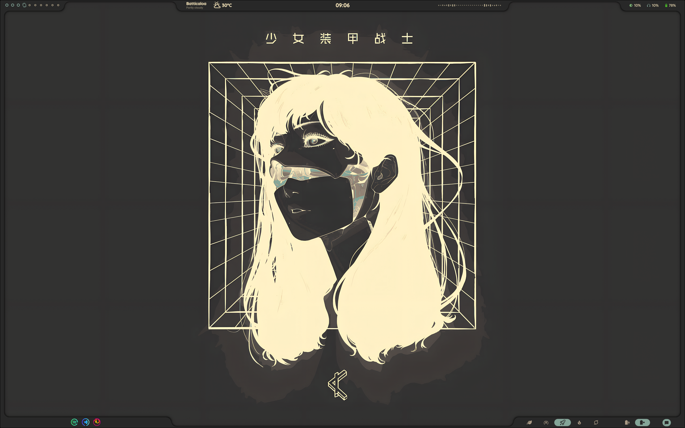
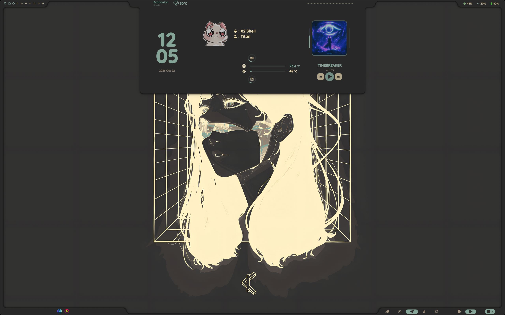
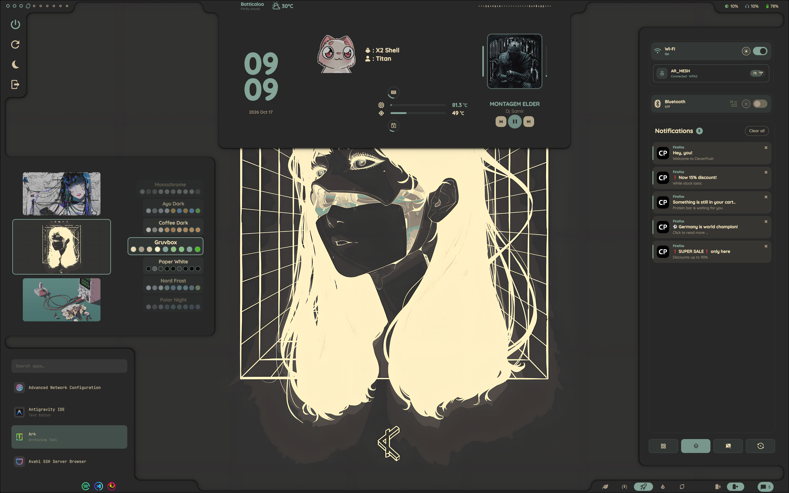
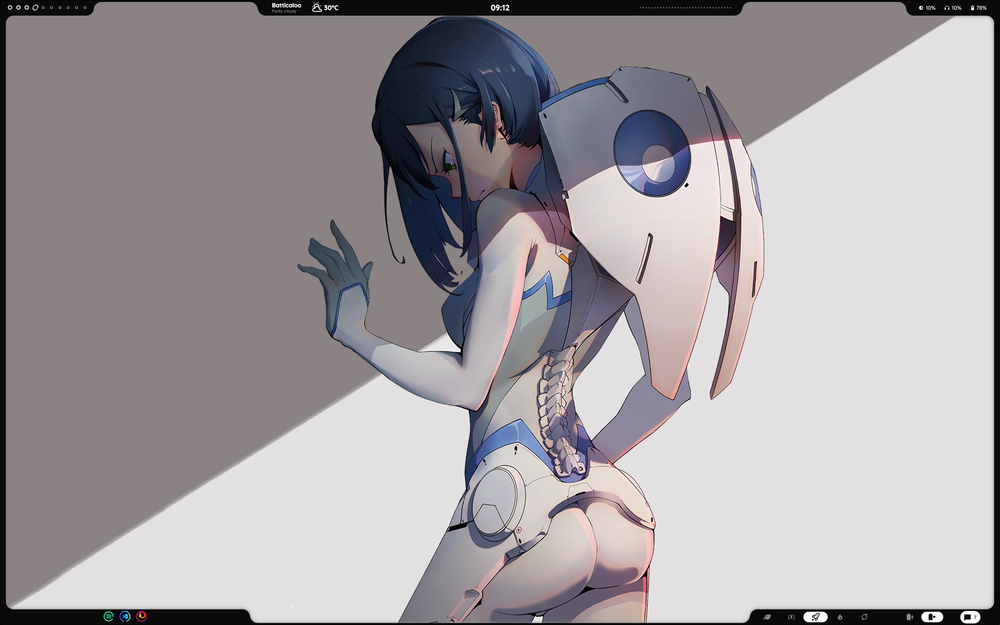
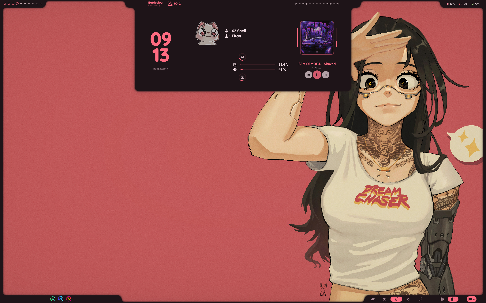
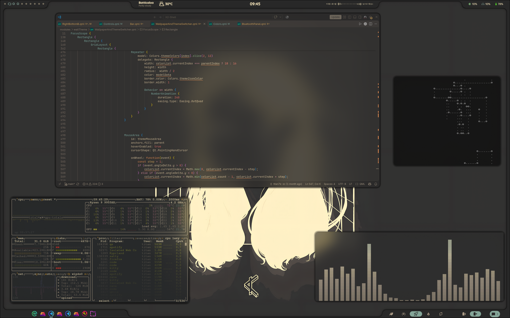
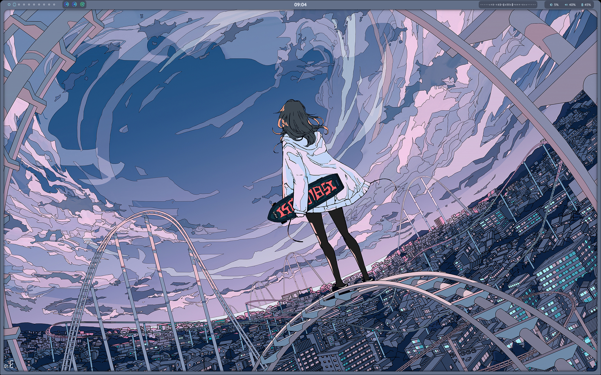

<div align="center">



# X2-Shell

### A polished, modular desktop shell for Wayland

Built with [Quickshell](https://quickshell.org/) and QML, X2-Shell combines a
minimal layer-shell bar with fast popups, system telemetry, media controls,
workspace tools, and a large collection of carefully tuned themes.

<p>
  <a href="https://github.com/titan7k-zc/X2-Shell">
    
  </a>
  
  
  
  
</p>

</div>

<p align="center">
  
  
  
</p>

<p align="center">
  
  
  
</p>

## ✨ What is included?

The default shell is a rounded, per-monitor layer-shell layout with animated
sections and popups. The repository also contains reusable modules that can be
enabled from `shell.qml` as the project evolves.

- **Responsive bar layout** — top, side, and bottom sections rendered for every
  connected screen through `Quickshell.screens`
- **Workspace and task controls** — Hyprland workspace information and a live
  taskbar
- **Application launcher and overview** — keyboard-friendly popup surfaces for
  launching applications and inspecting the desktop
- **System controls** — volume, brightness, battery, Wi-Fi, Bluetooth,
  notifications, power actions, and performance information
- **Media experience** — MPRIS/Spotify playback controls and a Cava audio
  visualizer
- **Weather and clock** — compact status information integrated into the bar
- **Wallpaper and theme switcher** — choose wallpapers through `awww` and
  switch between the palettes in `config/Colors.qml`
- **System telemetry** — CPU, memory, temperatures, GPU, storage, network
  activity, and uptime
- **Reusable QML components** — level bars, curves, indicators, controls,
  popups, and service singletons
- **Optional NVIDIA OLED brightness helper** — `x2-bright`, a small C program
  and systemd service that controls compatible panels through DPCD/AUX

## 🧩 Current entry point

The default launch path is intentionally small:

```text
shell.qml
└── modules/bar/bar_v2/Bar.qml
    ├── per-screen Wayland panels
    ├── weather / clock / audio visualizer
    ├── taskbar
    └── popup modules
```

Additional modules live in `modules/`, while shared UI and services live in
`components/` and `services/`. This makes it easy to replace the default bar,
add a panel, or reuse one of the existing controls without rebuilding the
whole shell.

## ✅ Requirements

### Runtime

- A Linux **Wayland** session
- A compositor with layer-shell support; Hyprland is the primary environment
  referenced by the current modules
- [Quickshell](https://quickshell.org/) with the Qt 6 QML modules required by
  your distribution
- Qt 6 modules used by the project, including `QtQuick.Effects`,
  `QtQuick.Shapes`, `Qt.labs.folderlistmodel`, and `Qt5Compat` where available
- The **Quicksand** font for UI text
- A **Nerd Font** (or another icon font) for symbolic icons

### Optional integrations

Install these only for the features you use:

| Tool | Used for |
| --- | --- |
| `awww` | Wallpaper queries and animated wallpaper changes |
| `cava` | Audio visualization |
| `curl` | Fetching remote media artwork |
| Spotify | Launching Spotify from the media controls |
| `nvidia-smi` | NVIDIA GPU usage and temperature telemetry |
| `brightnessctl` | Brightness control on systems using a standard backlight |
| `gcc` and `make` | Building the optional `x2-bright` helper |

## 🚀 Installation

### 1. Install Quickshell

Follow the [official Quickshell installation instructions](https://quickshell.org/docs/)
for your distribution. Make sure the Qt modules listed above are installed as
well.

### 2. Clone X2-Shell

```bash
git clone https://github.com/titan7k-zc/X2-Shell.git \
  ~/.config/quickshell/X2-Shell
```

### 3. Start the shell

```bash
quickshell -c X2-Shell
```

If your Quickshell build uses a different configuration command, pass the path
to this directory according to that build's CLI syntax.

## 🎨 Personalization

| Want to change | Edit |
| --- | --- |
| Colors and palettes | `config/Colors.qml` |
| Default component settings | `config/Controls.qml` |
| The active shell layout | `shell.qml` |
| Bar dimensions and geometry | `modules/bar/bar_v2/Bar.qml` |
| Wallpaper directory | `modules/wallTheme/WallpaperAndThemeSwitcher.qml` |
| Shared widgets | `components/` |
| Background services | `services/` |

### Wallpaper path

The wallpaper switcher currently contains a machine-specific default path:

```qml
property string folderpath: "file:///home/titan/disk0/syscustom/wallpapers/"
```

Change it to a `file:///...` URL pointing to your own wallpaper directory
before using the wallpaper picker. The switcher expects PNG, JPG, JPEG, or
WebP files and uses `awww` to apply them.

### Themes

`config/Colors.qml` contains the theme list and persists the selected theme
through Quickshell settings. Add a palette to `themeColors` or adjust the
existing palettes to make the shell your own.

## 🖥️ Optional: NVIDIA OLED brightness

`others/x2-bright` is intended for NVIDIA OLED panels that do not expose a
usable standard sysfs backlight interface. It installs:

- `/usr/bin/x2-bright`
- `/usr/lib/systemd/system/x2-bright.service`

Build and install it with:

```bash
cd ~/.config/quickshell/X2-Shell/others/x2-bright
make
sudo make install
sudo systemctl daemon-reload
sudo systemctl enable --now x2-bright.service
```

The service is guarded by the presence of `/sys/class/backlight/nvidia_0/brightness`
and `/dev/nvidiactl`. Read [`others/x2-bright/help.txt`](others/x2-bright/help.txt)
for manual control, service management, and uninstall instructions.

> **Important:** do not run the manual `x2-bright` watcher and the systemd
> service at the same time. They both try to control the same panel.

## 🗂️ Repository layout

```text
X2-Shell/
├── shell.qml                 # Default entry point
├── config/                   # Theme and shared settings
├── components/               # Reusable visual components
├── modules/                  # Panels, popups, bar layouts, and controls
├── services/                 # Reactive system and integration services
├── assets/                   # Screenshots and visual assets
└── others/x2-bright/         # Optional NVIDIA OLED brightness helper
```

## 🤝 Contributing

Ideas, improvements, and bug reports are welcome. When contributing:

1. Keep features modular and reusable.
2. Put shared colors in `config/Colors.qml` instead of hard-coding them in
   individual components.
3. Test changes on the compositor and hardware integrations they affect.
4. Document new external dependencies or setup steps.

## 🙏 Credits

X2-Shell is built on [Quickshell](https://quickshell.org/), created by
[outfoxxed](https://github.com/outfoxxed).

<!-- ## 📄 License

This repository currently does not include a license file. Until one is added,
the code remains under the default copyright terms. If you intend to
redistribute or modify X2-Shell, please add or request an explicit license
first. -->
